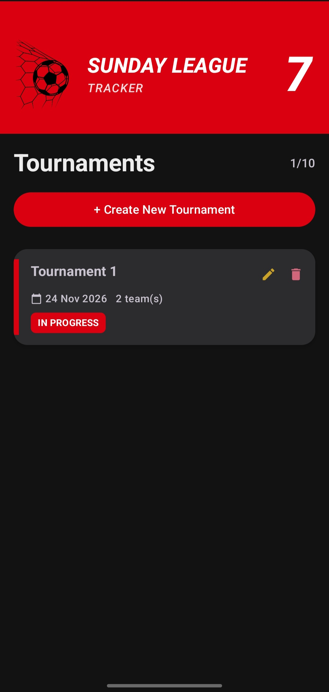
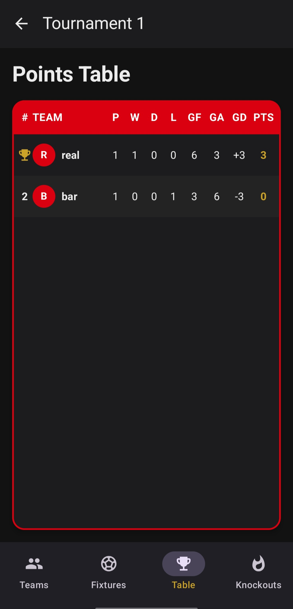
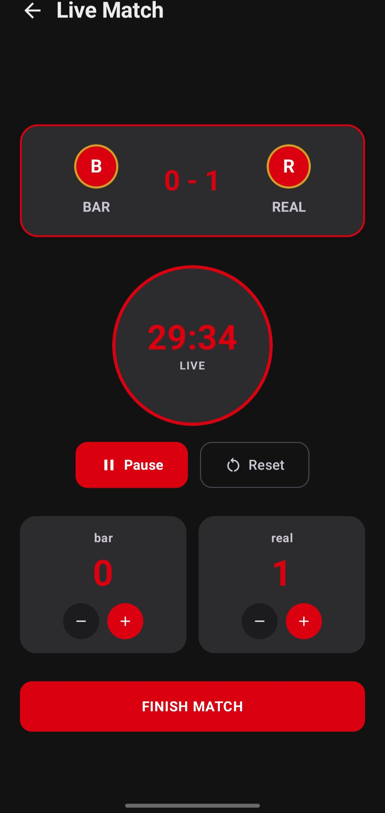
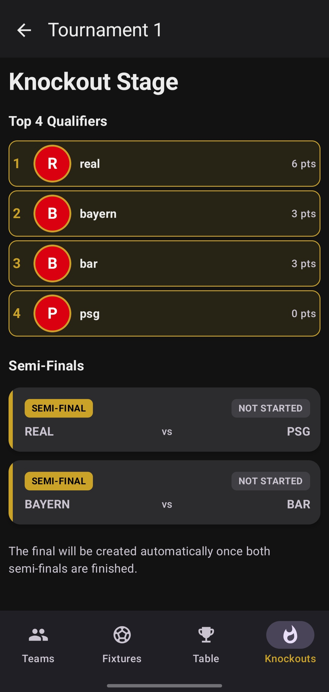

# ⚽ Sunday League Tracker

A lightweight, fully offline Android app for running one-day football tournaments — built for Sunday league organizers who need a fast, reliable way to track teams, fixtures, live scores, and standings without pen and paper.


## Overview

Sunday League Tracker was built to solve a real, recurring problem: running a weekly Sunday football tournament with nothing but a notebook and mental math. It replaces that with a clean, fast, fully offline Android app that a tournament manager can run entirely from their phone — on match day, with no internet required.

## Features

- **Multi-tournament management** — create, rename, and delete up to 10 saved tournaments, each with its own teams, fixtures, and results, all persisted locally and encrypted on-device
- **Team & fixture management** — create teams on the fly, manually pair fixtures, and track group-stage results
- **Live match engine** — a background-surviving match timer (via a foreground Android Service) that keeps counting down even if the app is closed, complete with pause/resume, reset safeguards, and an end-of-match alert
- **Automated points table** — wins, draws, losses, goal difference, and points, calculated live and sorted with standard football tiebreak rules
- **Knockout stage** — once the group stage completes, select semi-final pairings from the top 4 qualifying teams; the final is generated automatically once both semis conclude, including penalty-shootout handling for draws
- **Polished, theme-consistent UI** — built end-to-end in Jetpack Compose with a custom Material 3 theme, custom app icon, and a "What's New" release-notes dialog for returning users

## Tech Stack

| Layer | Technology |
|---|---|
| Language | Kotlin |
| UI | Jetpack Compose, Material 3 |
| Architecture | MVVM (`ViewModel` + Compose state) |
| Persistence | `EncryptedSharedPreferences` (AndroidX Security) |
| Background work | Foreground `Service` + coroutines |
| Navigation | Jetpack Navigation Compose |

## Architecture Notes

The app follows a straightforward MVVM structure: a single `TournamentViewModel` owns all tournament state and persists changes through a dedicated storage layer, while a background `Service` independently manages the live match timer — allowing the countdown and its notification to survive process death, app backgrounding, and navigation changes, then resynchronize correctly with whichever tournament owns the active match on next launch.


## Screenshots

<p float="left">
  
  
  
  
</p>

## Getting Started

```bash
git clone https://github.com/Addie3000/sunday-league-tracker.git
```

Open the project in Android Studio (Giraffe or newer recommended), let Gradle sync, and run on a device or emulator running Android 7.0 (API 24) or higher.

## Roadmap

- [ ] Export/share tournament results
- [ ] Custom team logos/colors
- [ ] Tournament history/statistics across seasons

## License

MIT